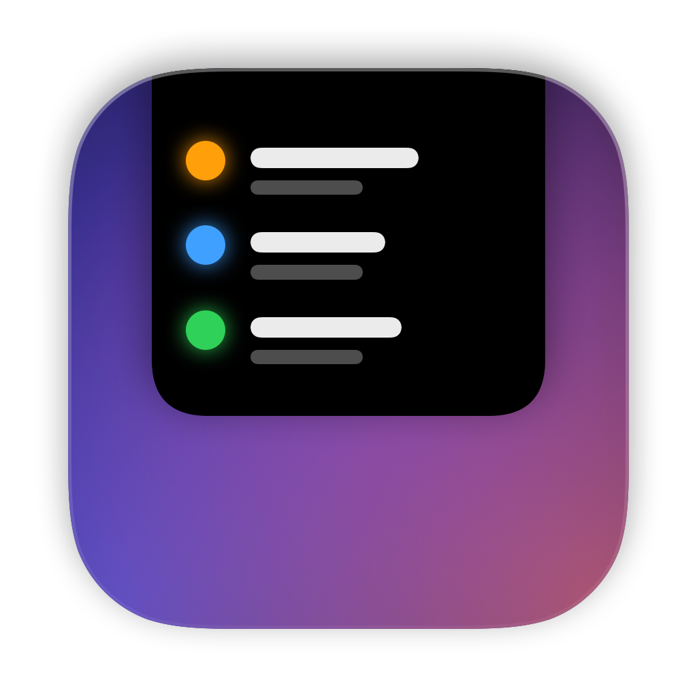
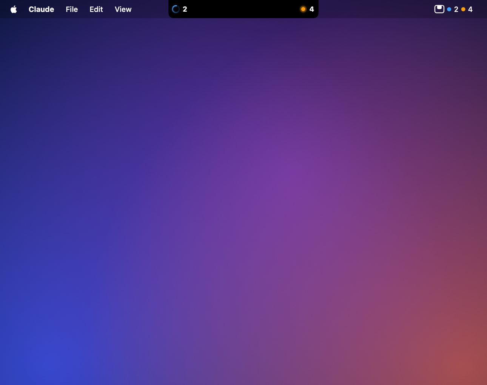
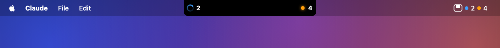
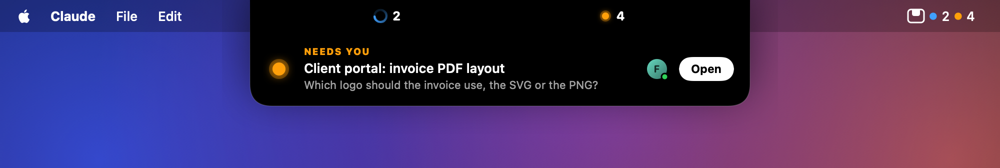
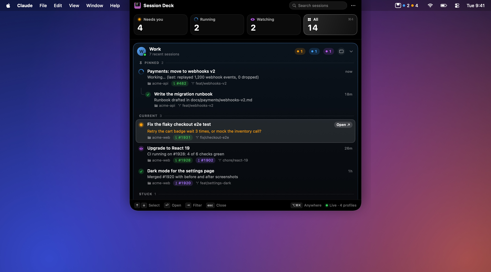
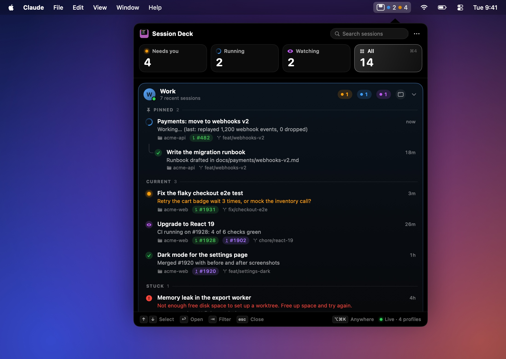
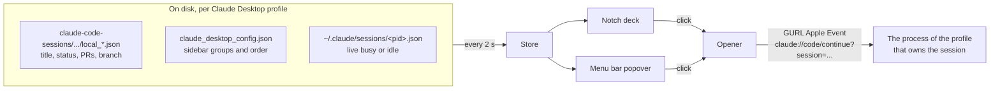

<div align="center">



# Session Deck

**Every Claude Code session, from every Claude profile, one notch away.**

A native macOS notch and menu bar app that shows what each of your Claude Code sessions is doing,
across all your Claude Desktop profiles, and opens the right conversation in the right window in one click.




</div>

## Why

You run Claude Code in several Claude Desktop profiles: a work account, a personal one, a client's
organization. Each window only knows its own sidebar, so "what was waiting on me again?" means clicking
through every window. Session Deck reads them all and puts the answer around your notch.

## What you get

<table>
  <tr>
    <th width="50%">All quiet</th>
    <th width="50%">Something happened</th>
  </tr>
  <tr>
    <td></td>
    <td></td>
  </tr>
  <tr>
    <td>Running sessions on the left of the camera, sessions waiting for you on the right. Nothing pending: a green check.</td>
    <td>A session finished or started waiting for you: a banner drops for 6 seconds. Click it to jump in.</td>
  </tr>
</table>

### The deck

Point at the notch, or press <kbd>⌥</kbd><kbd>⌘</kbd><kbd>K</kbd> from any app.



- **Four live counters that double as filters**: Needs you, Running, Watching, All.
- **One card per Claude profile**, in its own color, grouped like your sidebar: Pinned, your own groups
  (Current, Stuck, Later...), then the rest. Side sessions hang under their parent. Click a card's header to fold it.
- **Each row** shows the status, the title, the session's own last update, the project, its pull requests
  (GitHub colors, click to open), the branch and how long ago it moved.
- **Click a row** and the conversation opens in the Claude window that owns it, even with four profiles open.

### The menu bar



The same deck, for displays without a notch or with the notch turned off.

## Keyboard

| Keys | Does |
| --- | --- |
| <kbd>⌥</kbd><kbd>⌘</kbd><kbd>K</kbd> | Open or close the deck from any app (configurable) |
| <kbd>↑</kbd> <kbd>↓</kbd> | Select a session |
| <kbd>↩</kbd> | Open it in its Claude window |
| <kbd>⇥</kbd> / <kbd>⇧</kbd><kbd>⇥</kbd> | Next / previous filter |
| <kbd>⌘</kbd><kbd>1</kbd> ... <kbd>⌘</kbd><kbd>4</kbd> | Needs you, Running, Watching, All |
| <kbd>esc</kbd> | Clear the search, then close and give the keyboard back to the app you were in |

Type anything to search titles, projects, branches, PR numbers and the last update.

## States

| | State | Means |
| :---: | --- | --- |
| 🟠 | **Needs you** | The session asked you something, is blocked, or was interrupted |
| 🔵 | **Running** | Claude is working right now (its live status file says busy) |
| 🔴 | **Error** | The last turn failed |
| 🟣 | **Watching** | The work is ready for your review |
| 🟢 | **Done** | Marked complete |
| ⚪ | **Idle** | Nothing pending |

## How it works



Every profile runs the same app with the same bundle id, so `open claude://...` would land in whichever
instance Launch Services picks. Session Deck reads each running instance's `--user-data-dir` from its process
arguments, sends the `GURL` Apple Event straight to that process, then brings its window to the front.
A profile that is not running is started first, the way a profile launcher does.

## Install

```bash
git clone git@github.com:XAV-VINCENT/session-deck.git
cd session-deck
./build.sh
```

Needs macOS 14 or later and the Xcode command line tools (Swift 5.9+). The script builds a release binary,
wraps it in `Session Deck.app`, signs it ad hoc, installs it in `~/Applications` and starts it.

- **Open at login**: in the deck's `⋯` menu, or `--login-item on`.
- **First click**: macOS may ask to let Session Deck control Claude. Allow it: that is the Apple Event above.
- **Menu bar managers** (Thaw, Ice, Bartender): drag the Session Deck item out of the hidden section once.

## Configure

`~/Library/Application Support/SessionDeck/config.json` (`⋯` > Edit config..., then Reload config):

```json
{
  "instances": {
    "Claude": { "label": "Work", "color": "#5AA9FF", "order": 0 },
    "Claude-Personal": { "label": "Personal" },
    "Claude-Lab": { "hidden": true }
  },
  "notch": true,
  "recentDays": 7,
  "hotkey": "opt+cmd+k"
}
```

| Key | Default | Does |
| --- | --- | --- |
| `instances.<folder>.label` | `Default` for `Claude`, else the folder suffix | Name on the profile card |
| `instances.<folder>.color` | built-in palette | Hex color of the card |
| `instances.<folder>.order` | default profile first | Card order |
| `instances.<folder>.hidden` | `false` | Leave a profile out |
| `notch` | `true` | `false`: menu bar only, and the shortcut opens the popover |
| `recentDays` | `7` | Sessions idle longer are hidden (pinned and running ones always show; toggle in `⋯`) |
| `hotkey` | `opt+cmd+k` | `ctrl`, `opt`, `shift`, `cmd` plus a letter, digit or `space`; `none` turns it off |

`<folder>` is the profile's folder in `~/Library/Application Support`: `Claude`, `Claude-Personal`, and so on.

## Command line

```bash
SessionDeck --dump                    # the data as text
SessionDeck --demo                    # run with made-up sessions, for screenshots and recordings
SessionDeck --render <dir>            # PNGs of the views with your real data
SessionDeck --render-assets <dir>     # the app icon and the README pictures, from the demo data
SessionDeck --render-animation <dir>  # the README animation (needs `brew install webp` for img2webp)
SessionDeck --open local_<id>         # send one session link to its profile, without raising it
SessionDeck --login-item on|off|status
SessionDeck --selftest-notch          # drives the real panel with pointer moves and keys, prints PASS or FAIL
```

The binary is `~/Applications/Session Deck.app/Contents/MacOS/SessionDeck`. Every click is logged with the
process it went to in `~/Library/Logs/SessionDeck.log`.

## Privacy

- Reads local files only. No network, no telemetry, no account.
- The pictures and the animation in this README come from `--render-assets` and `--render-animation`, which
  draw the real views with made-up data, so none of your sessions ever ends up in an image.

## Caveats

- It reads Claude Desktop's private files (`claude-code-sessions`, `claude_desktop_config.json`) and uses the
  `claude://code/continue` link. A Claude update can change any of them; `--dump` is the first check.
- Not affiliated with Anthropic.

## Project layout

```
Sources/SessionDeck/
  App.swift            entry point, command line flags, menu bar item, login item
  Store.swift          scans every profile every 2 s and builds the snapshot
  Models.swift         profiles, sessions, states, pull requests
  Opener.swift         GURL Apple Event to the right process, window activation
  Notch.swift          the notch panel: hover, shortcut, banner, self-test
  DashboardView.swift  the deck: counters, profile cards, rows, banner card
  Keyboard.swift       the global shortcut (Carbon) and the deck keys
  Theme.swift          colors, status badges, the icon, notch shapes
  DemoData.swift       made-up sessions for --demo and the pictures
  Assets.swift         renders the app icon, the README pictures and the animation
  Render.swift         renders the views with real data, for debugging
  Config.swift         config.json and the log
```

Inspired by [Alcove](https://tryalcove.com) and [Atoll](https://github.com/Ebullioscopic/Atoll).
